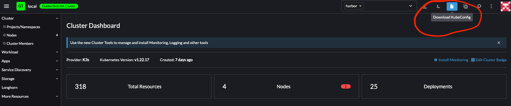

# Rancher

**Open Rancher: [https://rancher.dropbear-eel.ts.net](https://rancher.dropbear-eel.ts.net)** and sign in with GitHub.

!> Login only works once you've been onboarded: an admin adds your GitHub account to your own Rancher project. Until
then, Rancher refuses the login. Email [guldentechjobs@gmail.com](mailto:guldentechjobs@gmail.com) with your GitHub
username to get set up.

Rancher is the web console for the GuldenTech Kubernetes clusters. Each user gets their own Rancher project, and you
create your Kubernetes namespaces inside it. You can use the console in your browser, or work from your terminal
with the Rancher CLI.

## Rancher CLI (recommended)

The [Rancher CLI](https://ranchermanager.docs.rancher.com/reference-guides/cli-with-rancher/rancher-cli) logs in
with an API key and runs `kubectl` through Rancher, so there's no kubeconfig file to download or edit.

1. Install it: `brew install rancher-cli` on macOS, or download it from the
   [Rancher CLI releases](https://github.com/rancher/cli/releases).
2. In the Rancher console, click your avatar (top right) → **Account & API Keys** → **Create API Key**. Give it a
   description and an expiry, and copy the **Bearer Token**. It's shown only once.
3. Log in, and pick your project when asked:
   ```bash
   rancher login https://rancher.dropbear-eel.ts.net --token <bearer-token>
   ```
4. Use it like `kubectl`:
   ```bash
   rancher context current                  # which cluster and project you're on
   rancher context switch                   # pick a different one
   rancher kubectl get pods -n <namespace>
   rancher kubectl logs deploy/<name> -n <namespace>
   rancher kubectl apply -f app.yaml -n <namespace>
   ```

?> Treat the token like a password. If it leaks, delete it under **Account & API Keys**.

## kubectl with a kubeconfig file

If a tool needs a real kubeconfig (for example `helm`), log into Rancher, open the cluster, and click the
Kubeconfig file button shown below.



The file works as downloaded, with no edits needed. Save it somewhere private (for example `~/.kube/guldentech.yaml`)
and point tools at it with `--kubeconfig` or `KUBECONFIG`. It contains a token that expires after 30 days, so treat it
like a password and download a new one when it stops working.

## Create a namespace!

Dont forget to create a namespaces on the Rancher console for your project.
